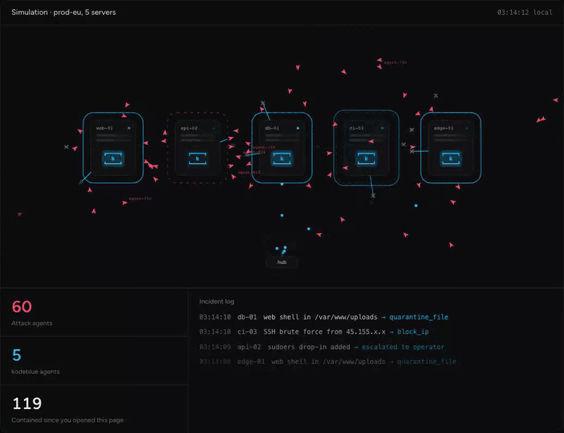

<h1 align="center">
  <picture>
    <source media="(prefers-color-scheme: dark)" srcset="docs/assets/kodeblue-logo-dark.svg">
    
  </picture>
</h1>

[](https://github.com/Problem99-io/kodeblue/actions/workflows/ci.yml)
[](https://github.com/Problem99-io/kodeblue/releases/latest)
[](LICENSE)

> Hackers have agents that attack 24/7. Now you have one that defends.

<p align="center">
  
</p>
<p align="center"><sub>The simulation from <a href="https://problem99.io/kodeblue">problem99.io/kodeblue</a>: one kodeblue per server, containing attacks as they land.</sub></p>

**An AI blue team for your Linux servers: SOC, incident response and SecOps in one.** One kodeblue per server, running as its own non-root `kodeblue` user. It does the work of all three, and never sleeps:
- **SOC:** it learns what the server normally looks like and notices changes to its most sensitive files within seconds
- **incident response:** it investigates anything suspicious in its own agent session, contains the attack when policy allows, and writes up what happened
- **SecOps:** it finds each service's vulnerabilities and coverage gaps, tunes its own detections every day, and posts updates to Slack

It is built to run on a small, cheap model behind any OpenAI-compatible API: deterministic sensors and filters do the heavy lifting, so the model only sees what survives them. Without a model configured, sensors, detection and monitors still run.

```
fast watch (5s) ─► sensors (60s, 0 tokens) ─► deterministic filters (0 tokens) ─► triage (small model, batched)
                                              + agent-written monitors (0 tokens)        │
                                                                                         ▼
              daily review session ◄─ reports/skills/monitors ◄─ one agent session per incident ─► respond (policy) ─► Slack
```

An optional **hub** (`kodeblue-hub`) gives a fleet one console: every server's incidents, reports, the agents' reasoning and tool calls (live), monitors, findings and pending approvals, and a way to message the agents. Servers only dial out to it, always over TLS (plain HTTP is allowed only to a hub on the same machine). Its **War room** drawer maps registered source-IP activity and links locations to incident context ([details](docs/hub.md#war-room)).

## Quick start

Each step is one command plus your model's API key, on Linux with systemd (amd64 or arm64; see [Requirements](#requirements)). The installers download the latest [release](https://github.com/Problem99-io/kodeblue/releases) for the server's architecture and check it against the release's `SHA256SUMS` before installing. To download and check the files yourself, or to build them, see [docs/deploy.md](docs/deploy.md#install-from-the-release-files) and [Build](#build).

### A. One server, no hub

```bash
curl -fsSL https://github.com/Problem99-io/kodeblue/releases/latest/download/install.sh | sudo sh -s -- --inference-url https://openrouter.ai/api --model <model>
```

Use any OpenAI-compatible endpoint, with or without `/v1` at the end. The installer asks for its API key, an optional Slack webhook, and optional Telegram bot credentials (secret input is not echoed), and starts kodeblue. kodeblue takes snapshots of the server for about 30 minutes. A learning session then explores the server and an assessment records its vulnerabilities (each can take up to 45 minutes), so expect it to start watching within one to two hours.

Without `--inference-url`, kodeblue starts watching after the snapshots, and the learning session and assessment wait until you set a model; they then run on their own. Set or change the model, and its key, with one command (it asks for the key and restarts kodeblue):

```bash
sudo kodeblue inference --url https://openrouter.ai/api --model <model> --key-file -
```

Telegram notifications can be used alone or alongside Slack. Standalone servers
configure them during installation; hub users configure **Settings → Telegram**.
See [Telegram setup](docs/hub.md#telegram) for bot and chat-ID instructions.

Then review the policy (response mode, protected users, IPs and units, budget) with `sudoedit /etc/kodeblue/kodeblue.toml`, and follow along with `sudo journalctl -fu kodeblue`.

### B. A hub and several servers

On the hub host, here with a self-signed certificate that servers pin:

```bash
curl -fsSL https://github.com/Problem99-io/kodeblue/releases/latest/download/install-hub.sh | sudo sh -s -- --public-url https://hub.example.com:8443 --self-signed
```

Or run the hub image: `ghcr.io/problem99-io/kodeblue-hub:latest` (see [docs/deploy.md](docs/deploy.md#with-docker)).

The installer asks for the first operator's password (twice) and starts the hub. Then:

1. Sign in at the public URL. The browser warns once about the self-signed certificate.
2. Open **Settings**, choose **Add connection** and paste your model's API key. The hub then asks which model every agent should use.
3. Open **Servers**, choose **Add server**, and run the command it prints on the server, as root or as a user with sudo. Start the line with a space so the token stays out of your shell history (see [docs/deploy.md](docs/deploy.md#keep-the-token-out-of-your-shell-history)). The command looks like this:

```bash
 f=$(mktemp) && r=$([ "$(id -u)" = 0 ] || echo sudo) && { curl -fsSL --proto =https --proto-redir =https -k --pinnedpubkey 'sha256//…' -o "$f" https://hub.example.com:8443/install.sh && echo "<sha256>  $f" | sha256sum -c - && printf '%s\n' kbe_… | $r sh "$f" --hub https://hub.example.com:8443 --pin 'sha256//…' --token-file -; s=$?; rm -f "$f"; (exit "$s"); }
```

It saves the installer, checks its hash before running it as root, and passes the single-use token on stdin so it never appears in a process's arguments. The server takes the hub's model and key at enrollment and asks nothing. A server that has no model yet watches with its deterministic detection, and the hub shows that its learning is waiting for one.

For a hub on the internet, we recommend putting it behind Cloudflare with a `cloudflared` tunnel: the hub host opens no port, servers verify Cloudflare's public certificate (no pin), and Cloudflare Access can guard the console. Cloudflare then sees the traffic between servers and the hub; see [docs/deploy.md](docs/deploy.md#behind-cloudflare) for the setup and the trade-off.

To hide the console from everyone but your office or VPN, add `--console-allow 203.0.113.7,10.66.0.0/24` (servers can still enroll and sync). For a real certificate, a reverse proxy, Docker or WireGuard, see [docs/deploy.md](docs/deploy.md) and [docs/hardening.md](docs/hardening.md).

## The problem

Scanning, brute forcing and exploiting used to take a person at a keyboard. Now it takes an agent loop and a list of IPs. The attacking side is automated; on most servers the defending side still waits for a human.

- **They never log off.** Every public IP is scanned, brute forced and probed around the clock. Your team goes home; theirs doesn't.
- **The real alert hides in the noise.** Most monitoring fires on every package upgrade and worker restart. A planted SSH key looks like one more line in the day's noise, and people learn to stop reading.
- **Minutes for them, hours for you.** An intruder goes from a foothold to persistence in minutes. A human-only response starts when someone reads the alert, often the next morning.
- **A 24/7 security team is out of reach.** Round-the-clock SOC analysts, incident responders and security engineers cost more than most teams spend on their servers, so most servers have no one watching at all.

kodeblue puts a security team on every server. It sits next to the processes, files and logs it protects, never logs off, and catches an attack within seconds.

## How it works

One kodeblue per Linux server, running as its own non-root user. It can read every file and process on the host, but its sandbox lets it write only its own state, and containment goes through a separate root helper ([details](docs/kodeblue.md#running-as-its-own-user)). It does the work of a SOC analyst, an incident responder and a SecOps engineer, except it never sleeps and it already knows the machine. The examples below are illustrative.

**1. Learn what normal looks like.** Repeated snapshots and an agent that explores the host. It writes a server profile, monitors and skills for this exact machine. Signs of compromise that are never legitimate (a uid 0 account, `ld.so.preload`, a deleted or in-memory executable, a package checksum mismatch, a shell connecting out) are still flagged while it learns, so an already-compromised server is not learned as normal.

```
server profile · web-01
role     nginx + node api, postgres replica
admins   ram (ed25519 …9f2c), deploy (ci key)
normal   nightly unattended-upgrades, backup cron 02:00, workers restart on deploy
exposed  22 from office /24, 443
risk     postgres listening on 0.0.0.0:5432
+ 6 monitors, 2 host skills written
```

**2. Notice change in seconds.** Keys, accounts, sudoers, cron, systemd, PAM and `ld.so.preload` are checked every 5 seconds, and a change starts a sweep at once. A critical change, such as a key planted for root, becomes an incident within seconds; other changes are confirmed on the next sweep, a minute or two later.

**3. Filter first, model second.** Deterministic sensors and filters cost zero tokens and remove the noise. A small, cheap model only sees what survives them, which keeps false positives and spend low.

```
changes seen today                                          1,284   0 tokens
left after baseline, package checksums, debounce               33   0 tokens
medium or high, sent to the small model                         4   ≈ $0.001
suspicious, opened as an incident                               1   one agent session
```

**4. Investigate like an incident responder.** Each incident gets its own agent session with read-only host tools. It gathers evidence, reasons about it, and reaches a verdict you can read step by step.

```
incident #41 · blue-responder session
host_read /home/deploy/.ssh/authorized_keys   key comment "backup@ci", not in the learned baseline
host_exec last -i deploy                      deploy login from a new /24, 3 min before the change
host_exec ss -tnp                             outbound 185.220.x.x:4444 from /tmp/.x/kworkerd (deleted)
verdict   true_positive · confidence 0.94
```

**5. Contain it, reversibly where it can.** When policy allows, it blocks the IP, disables the key, quarantines the file, stops the unit, locks the account or kills the process through a root helper. In the default `recommend` mode each action waits for your approval; in `contain` mode it runs at once. An administrator's keys and account (root, uid 0 accounts, sudo/wheel/admin members and `protected_users`) are never touched: for those it recommends, and you decide. Every action is rate-limited, journaled and posted to Slack. Blocks, disabled keys, quarantined files, stopped units and locked accounts can be undone; a killed process cannot, so its binary is kept for forensics first. Locking an account also kills its processes, and those do not come back on undo.

```
disable_ssh_key   deploy · backup@ci            undo: sudo kodeblue respond undo act_3f9c2a71e0
kill_process      pid 3312 · /tmp/.x/kworkerd   binary preserved for forensics
block_ip          185.220.x.x                   undo: sudo kodeblue respond undo act_8b41d07c55
```

**6. Get sharper every day.** A daily review reads the outcomes, tunes noisy monitors, prunes stale rules and covers new blind spots, so the system adapts to the server instead of you adapting to it.

```
daily review · blue-reviewer
tuned monitor nginx-5xx: threshold 20 → 60 (7-day outcomes: 0 true)
pruned allow rule for old deploy key (expired)
added monitor: postgres must not listen on public interfaces
updated server profile with the new worker service
```

The full pipeline, layer by layer, is in [docs/kodeblue.md](docs/kodeblue.md).

## Learning from false positives

An alert nobody trusts gets ignored. kodeblue treats every benign verdict as something to learn, so the same harmless change does not alert twice, and it keeps checking that what it learned is still right.

| Who decides it was benign | What kodeblue learns |
|---|---|
| **Triage** (small model), confident (≥ 0.85) | The item is absorbed into the baseline, and the model may add a narrow allow rule: it must match the item, have at least 8 literal characters, not start with `*`, and it expires after 90 days. |
| **Responder** (incident session), verdict `false_positive` or `benign_change` | The items are absorbed, and the responder is told to leave a monitor, skill or allow rule so the next similar case is cheaper. |
| **You**, `kodeblue ack <id> [--allow]` | The finding is closed as benign and its item absorbed into the baseline; `--allow` also adds an allow rule for that exact item. |
| **You, ahead of time**, `kodeblue maintenance 2h "deploy v42"` | Changes that are not critical are absorbed during the window, protected ones included (a new key for a non-root user, a sudoers change); critical ones, such as a key for root, still alert. The window is posted to Slack. |

Every day the reviewer reads a 7-day outcome table per rule, then tunes or disables noisy monitors, prunes stale allow rules, and adds monitors for blind spots it found. Tomorrow's triage is cheaper and quieter than today's.

What it never learns on a model's word:
- **Protected detections** (such as new SSH keys, uid 0, sudoers, privileged groups, PAM, `ld.so.preload`, SUID files and checksum mismatches) are never allow-listed or absorbed by a model. A benign verdict on one asks a human.
- **An attacker's first login** never makes its IP "known": after learning, a flagged login is learned only once it is judged benign. (Logins already in the auth log at install, or seen during the learning window, are learned as normal, so look over the learned login sources after setup.)
- **Maintenance windows** never absorb an item that an open finding is about.
- Every automatic decision is recorded, and the reviewer reads those records.

The full list of noise filters is in [Keeping false positives down](docs/kodeblue.md#keeping-false-positives-down-without-going-blind).

## Why

- **Cheap to run.** Sensors, baselines, package-checksum checks, debounce, dedupe and allow rules cost no tokens. A small model triages what is left, in batches. With a small model a real incident costs cents, and a daily budget caps spend.
- **Few false positives.** Stable identities, multi-snapshot baselines, /24 login sources, a low-severity digest, a triage feedback loop and a daily tuning review. See [docs/kodeblue.md](docs/kodeblue.md).
- **Hard to talk out of an alert.** Protected detections (such as new SSH keys, uid 0, sudoers, privileged groups, PAM, `ld.so.preload`, SUID files and checksum mismatches) can never be waved through by a model. Host data is treated as untrusted input.
- **Safe containment.** Agents have no shell, and their tools only read the host. Containment goes through a socket-activated root helper that reads a root-owned policy (`off`, `recommend` or `contain`). Every action is rate-limited, journaled and posted to Slack, and every action can be undone except killing processes (also those of a locked account). The hub can only tighten that policy, never loosen it.

## Safe enough to let it act

An agent that can touch production has to be harder to fool than the attacker is clever. We run kodeblue every day on the services we operate, and several of these guard rails exist because a model tried to overreach.

| Guard rail | What it means |
|---|---|
| Ask, then act | The response mode is `off`, `recommend` (the default) or `contain`. In `recommend`, containment requests wait for an operator: `sudo kodeblue respond approve act_…` (or Approve in the hub). |
| Read-only by design | Agents have no shell. They get allowlisted read-only commands, and secret paths are refused. |
| Policy outside the model's reach | Actions go through a socket-activated root helper that re-reads a root-owned policy, and refuses to run if anyone but root can write it. |
| Some detections always need a human | New SSH keys, uid 0 accounts, sudoers, privileged groups, PAM, `ld.so.preload`, SUID files, checksum mismatches and more can never be waved through on a model's word. |
| Host data is treated as hostile | Logs, files and process names are attacker-controlled. Instructions found inside them count as signs of compromise. No agent can browse or fetch. |
| Standing answers only with approval | For attacks that keep coming back, an agent can propose a containment rule ("block every address that brute-forces SSH"). It does nothing until a person approves it on the hub or with `sudo kodeblue rules approve`; it is limited per hour, expires, and the root helper checks every action it takes. |
| Undo where it is possible | Each action is journaled with its undo recipe, rate-limited and posted to Slack (once a hub or Slack webhook is set up). Blocked IPs, disabled keys, quarantined files, stopped units and locked accounts can be undone; a killed process cannot, so its binary is preserved first, and the processes killed when an account is locked do not come back. |

## What it costs

Sensors and filters do the heavy lifting for free. The model only sees what survives them, and prompts are built for caching.

What the model part costs depends on the model you choose. How many tokens kodeblue uses depends mostly on what happens on the server; what those tokens cost depends on the model's price per token, and the figures below are an example for a small model:

| Stage | When | Cost with a small model |
|---|---|---|
| Sensors, detection, monitors | every minute | $0 |
| Triage batch | only when findings survive the filters | ≈ $0.001 |
| Incident investigation | per real incident | ≈ $0.01–0.05 |
| Daily review | once a day | ≈ $0.01–0.03 |
| Learning and vulnerability assessment | once, at install (and on a relearn) | the largest single spend; not capped by the daily budget |

These are estimates at about $0.20 per million input tokens, with prompt caching; without it, investigations and reviews can cost two to three times as much. A model that costs ten times as much per token costs about ten times as much here; a model you host yourself costs only its hardware. Whatever the model, `[budget] daily_usd` caps the daily spend: past it, triage stops, the daily review already stops at 80% of it, and only critical incidents still get an investigation, up to a hard stop at twice the cap; messages you send from the hub run up to 1.5 times the cap. The cap counts the cost your endpoint reports for each call; if it reports none, set your model's prices in `[budget]`, or the cap is not enforced.

## Requirements

- Linux with systemd, amd64 or arm64
- `curl`, to install
- an OpenAI-compatible model endpoint (a hosted API, OpenRouter, or your own vLLM, Ollama or LiteLLM; for a keyless endpoint give any placeholder as the key), or none: without one, kodeblue runs sensors, detection and monitors, and its learning waits until you add one
- to build: Go (the version in `go.mod`)
- for the hub: a small Linux host or a Docker host that your servers can reach over HTTPS

## Documentation

| Page | What |
|---|---|
| [docs/deploy.md](docs/deploy.md) | deploying the hub (systemd, Docker, reverse proxy, Cloudflare tunnel, self-signed), adding servers, upgrades, backups, uninstall, building |
| [docs/hardening.md](docs/hardening.md) | what is encrypted, restricting network access, WireGuard, TLS and pins, operator accounts, per-server policy, model keys, monitoring kodeblue itself |
| [docs/hub.md](docs/hub.md) | the hub: console, connection and security model, settings, CLI |
| [docs/kodeblue.md](docs/kodeblue.md) | how detection, triage, incidents, containment and Slack work on a server |
| [docs/engine.md](docs/engine.md) | the agent engine kodeblue runs as a child process |

## Operate

On a server:

```bash
sudo kodeblue status                         # heartbeat, spend vs budget, open incidents, monitors
sudo kodeblue incidents ; sudo kodeblue incident <id>
sudo kodeblue findings --status needs_ack ; sudo kodeblue ack <id> [--allow]
sudo kodeblue maintenance 2h "deploy v42"    # planned work: absorb non-critical changes
sudo kodeblue respond list                   # then: respond approve|deny|undo <id>
sudo kodeblue rules                          # containment rules; then: rules approve|reject|pause|delete <id>
sudo kodeblue vulnerabilities                # every known vulnerability on this server
sudo kodeblue inference                      # show the model endpoint (set it with --url, --model and --key-file -)
sudo kodeblue upgrade v0.1.7                 # install a release (or Update on the hub); checked against its SHA256SUMS
```

On the hub:

```bash
sudo -u kodeblue-hub kodeblue-hub user list --data /var/lib/kodeblue-hub    # also: user add|del <name>
sudo -u kodeblue-hub kodeblue-hub fleet status --data /var/lib/kodeblue-hub
sudo -u kodeblue-hub kodeblue-hub pin --data /var/lib/kodeblue-hub
```

## Releases

| Channel | Where | When |
|---|---|---|
| stable | [Releases](https://github.com/Problem99-io/kodeblue/releases/latest) `vX.Y.Z`, image `ghcr.io/problem99-io/kodeblue-hub:latest` / `:vX.Y` / `:vX.Y.Z` | when a maintainer tags a version |
| nightly | the `nightly` pre-release, image `:nightly` | every night that `main` changed; for testing, not production |

Releases are built by `.github/workflows/release.yml` after the full test suite, and the build is reproducible: the same commit gives byte-identical tarballs.

## Build

```bash
deploy/build-dist.sh dist        # dist/agent/: install.sh + kodeblue-linux-{amd64,arm64}.tar.gz + SHA256SUMS
                                 # dist/kodeblue-hub-linux-{amd64,arm64}.tar.gz: hub bundles
docker build -f deploy/hub/Dockerfile -t kodeblue-hub .   # hub image (serves the agent release itself)
```

`ARCHES="amd64"` builds one architecture; `VERSION=…` stamps a version (default: `git describe`). Builds are reproducible with GNU tar (`SOURCE_DATE_EPOCH` defaults to the commit time).

## Layout

| Path | What |
|---|---|
| `cmd/kodeblue` | daemon, CLI, MCP tool server, root response helper |
| `internal/blue/` | sensors, detect, monitor, triage, store, runtime (agent engine child), mcpserver, respond, notify, daemon |
| `blue/` | **model instructions**: agent roles (`agents/`), triage prompt, bundled skills |
| `internal/agent/sysprompt/base.md` | base system prompt for every kodeblue session |
| `cmd/kodeblue-hub`, `internal/hub/` | the hub: enrollment, agent API, operator console (`internal/hub/web`) |
| `internal/blue/hublink`, `internal/blue/hubproto` | the server side of the hub connection and the wire contract |
| `deploy/` | installer, release build, systemd units, example config, `hub/` (hub unit, installer, Dockerfile), `e2e/` test servers |
| `cmd/kodeblue-engine`, other `internal/` packages | the agent engine kodeblue runs as a child process (`kodeblue-engine`); see [docs/engine.md](docs/engine.md) |

## Contributing and security

See [CONTRIBUTING.md](CONTRIBUTING.md) and [CODE_OF_CONDUCT.md](CODE_OF_CONDUCT.md). Where we most need help: [integrations](CONTRIBUTING.md#where-we-need-help-integrations) that let kodeblue pull alerts and cases from SIEM, SOAR, EDR and threat-intelligence systems. Report vulnerabilities privately as described in [SECURITY.md](SECURITY.md), not in public issues.

## License

Apache License 2.0. See [LICENSE](LICENSE) and [NOTICE](NOTICE).
