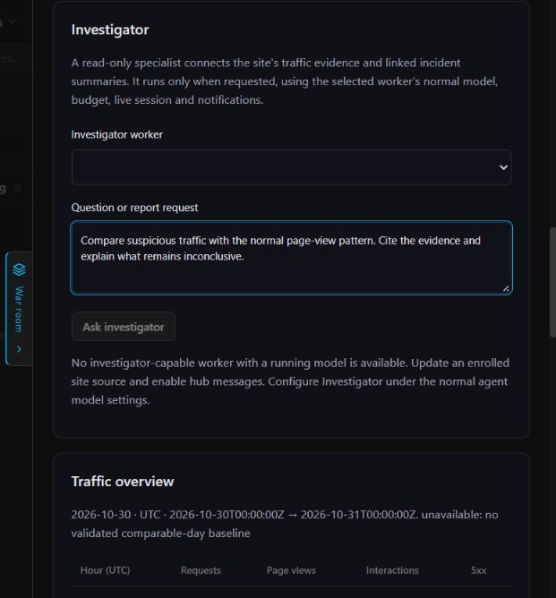
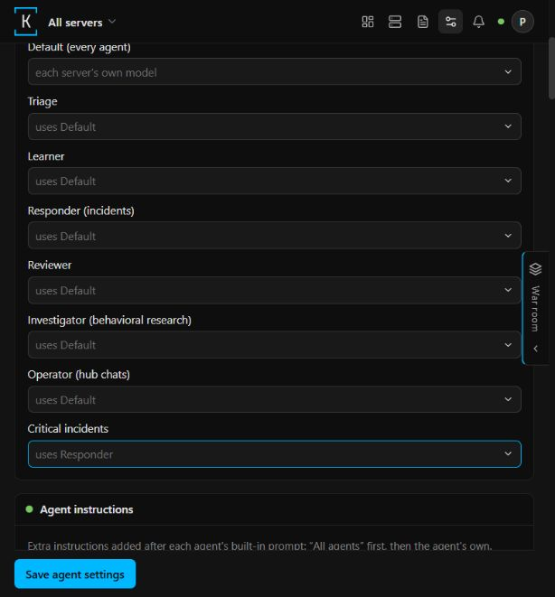
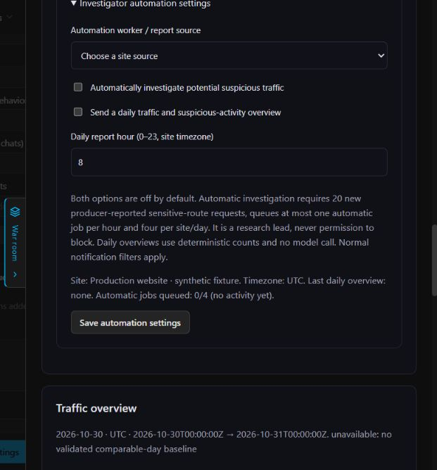

# Behavioral investigator

This feature adds `blue-investigator` as a native KodeBlue agent on top of the
behavioral research store. It uses the same embedded agent catalog, model and
instruction settings, message delivery, incident concurrency slots, cost ledger,
live transcripts, Stop control, case board and notification sender as other agents.
It does not add a separate application, window, agent roster or alert transport.

## Use

Enable the research foundation on the hub, update the hub and worker agent, and
configure a research site with explicitly selected enrolled sources. The worker
must be one of those sources, report investigator support and a running model,
and permit `hub.accept_messages` in its root-owned configuration.

Set an optional **Investigator (behavioral research)** model and instructions in
the existing fleet/server agent settings. Otherwise the normal default agent model
applies. The worker advertises that effective model in its usual status sync.

Open **War room > Research layer**, select the site and report date, choose an
eligible worker, enter a question, and press **Ask investigator**. The hub queues
an `investigate` operator message. The resulting `research` case appears on the
normal case board, with live transcript, cost and Stop. War room shows recent jobs
and their replies, refreshing every ten seconds only while a job is outstanding.
The final report uses the existing notification pipeline, including its configured
destinations, minimum severity, retries and deduplication. Research completion has
severity `info`; destinations configured to forward only higher severities may
skip it. The report remains available in the case and War room.

Asking a follow-up from a research case's normal chat box opens the same War room
and copies the question into its form. Select the intended site/day/worker and
submit a fresh grant; the operator liaison cannot adopt the research session.

Manual questions remain available. Two independent, opt-in automation settings
are described below. Passive ingestion itself never calls a model.

## Automation settings

Open **Settings > Agent models > Investigator automation settings in War room**,
or expand **Investigator automation settings** in War room's Research layer.
Choose the site first. Policies apply only to that site and both switches default
to off. The independent Save button does not alter agent model settings.

- **Automatically investigate potential suspicious traffic:** select an updated
  worker accepting hub messages. A deterministic check of received counters runs
  about every five minutes. At least 20 additional producer-reported sensitive-route
  requests must arrive after the enable-time baseline or preceding queued investigation.
  Browser pageview claims cannot satisfy that condition. The hub permits at most
  four automatic jobs per site/calendar day, with at least one hour between job admissions,
  including across midnight. These are research leads, not maliciousness or actor
  verdicts, and they cannot authorize blocking. Jobs use the same grant limits,
  message rate limits, semaphore, model budget and Stop path as manual requests.
- **Send a daily traffic and suspicious-activity overview:** choose an enrolled
  site source for attribution and a delivery hour, default 08:00 in the site's
  IANA timezone. The hub queues the previous calendar day's request/pageview/
  interaction/error counts, research leads and coverage caveats through the normal
  notification outbox. It uses **no model**, works without a running model, and
  reports empty days too without claiming that unobserved traffic was safe.
  Normal notification destinations and severity filters apply; overviews are
  `info` and always remain available in notification history. On startup or enable,
  only the most recent due day is considered, without a backlog flood.

Enabling automatic investigation does not replay traffic already recorded before
enablement. Late-arriving records for the current site day count as new received
evidence, with event/receipt times kept distinct. Configuration
and durable cursors live in the hub control database, not the model-free analytics
store. Daily delivery is deduplicated by site/day and suspicious-job reservations
commit atomically with their native messages, so restarts do not reissue work.
Unsuccessful admission waits five minutes and exposes a reason in settings;
repeated identical reasons are not logged on every check. Counter losses reset
the baseline without a model call; coverage losses remain explicit.

Changing a site's sources, collection scope or timezone pauses automation until an
operator saves the policy again, approving the current scope. Disabling automatic
investigation withdraws queued automatic jobs; delivered/running jobs remain under
the normal live-session Stop control. Manual investigations are unaffected.
Each site has one bounded configuration/state row (at most 64 site policies).

## UI examples

Synthetic local preview; no real telemetry or model credentials are configured.
The worker-unavailable state is intentional in this fixture. Dispatch, grants,
accounting, Stop and notifications are exercised with fake engine/HTTP fixtures.

## Read scope and budgets

Admission creates a durable, expiring grant in the hub control database. The
analytics database remains deterministic and independent of model execution.
The grant fixes the site, report day, enrolled source set, selected worker and
highest accepted evidence sequence. The overview is captured at admission;
individual details may later expire or be evicted. It is not a transactional
snapshot spanning the hub and analytics databases.

The worker can call `research_context(job_id, view, after)`:

- `overview`: saved daily counts, coverage caveats and grant metadata.
- `evidence`: at most 25 observations, paged by sequence within the granted site's
  local calendar day and fixed sequence ceiling. Only still-granted sources and
  explicitly untrusted browser observations are included.
- `sources`: bounded incident/finding titles and summary previews for up to four
  granted sources per call. At most four newest records per kind/source are
  returned within the selected update-time window. This is a sampled view, not complete
  historical reconstruction; missing or delayed source syncs remain unknown.

The broker authenticates the existing enrollment key and checks that the job is
delivered, assigned to that worker, unfinished and unexpired. Removing the worker
from the site withdraws the grant; removed or revoked sources are excluded.
Other enrolled servers cannot use the job, even when they are linked sources.
Finished/expired jobs cannot be read. Operators retain their normal authenticated
read access to the research store; a server key gains no general research access.

Each job has 24 queries, at most 32 KiB per response, an 8,000-byte stored analysis
plus its fixed advisory label, a 30-minute admission/grant
deadline and a ten-minute model run. At most one job is outstanding per worker,
32 across the fleet, with at most 128 unexpired grant rows retained. Expired grant
metadata is pruned on admission; normal message retention also deletes it through
its foreign key. Replay receipts on a worker are a single bounded map of at most
128 grants, expiring just after the grant deadline. They prevent repeat dispatch
and repeat billing/notifications after an accepted message is replayed.

The daemon rechecks the normal daily model budget after entering its existing
incident semaphore and permits one investigator at a time. The normal configured
model pricing rules still apply; a provider without cost/pricing information has
the same limitations as existing agents. Cancellation, timeout or engine loss
aborts before live ownership is released. Operator chat cannot adopt a research
session; a follow-up question creates a fresh scoped job.

## Responsibilities and conclusions

The investigator connects facts; it does not replace responder containment,
learner configuration, assessor vulnerability analysis or reviewer tuning. It has
only the scoped research broker tool; even local evidence reads must use the
assigned job grant.
No shell, arbitrary SQL, raw file/container reads, secrets, write tools, incident
resolution, rules/monitor mutation or containment tools are granted. Linked
container/workload context is read from the site's enrolled sources' synced
records, not through blanket control of all containers.

The role prompt requires cited facts, separate similarity and communications,
competing hypotheses, contradictions, coverage gaps and a falsifying discriminator.
Shared fingerprints or proxies do not prove actor identity. Untrusted source text
cannot expand a grant or authorize an action. Recommendations are advisory; the
admin decides any response under the existing policy. Multi-agent council chat
and ballots are not implemented by this investigator feature.
