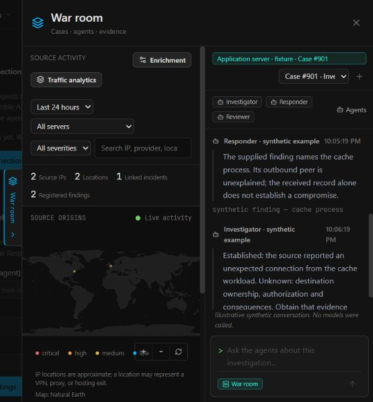

# Investigator and War room

War room is a native KodeBlue investigation workspace for enrolled servers and
their monitored containers, services, processes, authentication, integrity,
vulnerabilities and network activity. It opens from the fleet/server context or
**Discuss in War room** on an existing case. It does not require a website,
collector group or the optional analytics database.

The workspace keeps the activity map on the left and the case discussion on the
right. It reuses the normal case-chat composer, message rendering, model and
instruction settings, case board, live sessions, Stop, model budgets, accounting
and notification pipeline. Very narrow phone screens stack the panes.

## Start a discussion

Update participating servers, enable their model and hub messages, then open
War room. The current server/case is carried in automatically. Open **Agents**
to select the Investigator's server and up to four Responder, Reviewer, Learner
or Operator turns. Multiple roles on the same server are supported. Only selected
servers plus the explicitly linked case's server enter the evidence grant.

The Investigator opens, selected agents answer one at a time, and the Investigator
concludes with established, contradicted and unknown vectors. Agents may pass.
Read-only role delegates use each role's normal model and operator instructions,
with a separate native session and exactly one scoped evidence tool. They do not
adopt or interrupt normal response, review or learning sessions, and cannot use
those roles' write/response tools. Source records are received evidence, not a
claim of live shell or container inspection. The admin decides any response.

Follow-up questions start another bounded round. Input during a turn reaches the
next speaker; input during the closing turn starts another round if capacity
remains. Pause stops new turns. End withdraws queued work and prevents subsequent
turns; an already dispatched turn may finish. Use its native session **Stop** to
abort it. Ended discussions cannot reopen themselves after a failed completion.

## Evidence and limits

`research_context` is the shared scoped broker (the internal tool name is retained
for compatibility). Native jobs expose:

- `overview`: assigned servers/case, time window, quoted discussion and limits.
- `evidence` or `sources`: bounded synced cases, findings, services,
  vulnerabilities and actions. Relevant case-linked findings take priority.
- `traffic`: optional received observations from configured collectors already
  linked to the granted servers. No collector means no traffic evidence, without
  blocking the infrastructure investigation.

Source turns read only their own server's records. Lead turns read the explicitly
selected sources. All turns intentionally share the quoted case discussion.
Research reports are excluded from source evidence; incident summaries remain
attributed case analysis, not independent corroboration. Native record responses
are sampled (two per kind/source plus the linked case), minimize fields and mark
size truncation. They do not expose credentials, config blobs, raw files or shell
access. Inventory can be older; missing/stale evidence stays unknown.

Grants bind current enrollment key hashes privately. Revocation, deletion or
re-enrollment withdraws access; a replacement machine cannot inherit an old case
grant. Hashes are not returned to clients or models. Native discussions persist
in the control database, with atomic turn/message reservation, replay protection,
24 reads per job, 32 KiB responses, native concurrency/budget controls and cost
booking on the selected role's model. Investigator turns have 24 iterations;
role delegates have 12, or a lower configured investigation limit. Each model
run has ten minutes and the admission grant has thirty minutes.

A discussion has at most three rounds, four specialist turns per round, 32
entries/96 KiB and a two-hour admission lifetime. At most 32 conversations and
128 unexpired grants are retained. Individual entries fit 2,400 encoded bytes;
long model text is marked as an excerpt with a link to its full native report.
Overlarge admin messages are rejected rather than silently shortened. Context
includes the newest twelve entries, up to 700 UTF-8-safe bytes each, plus the
latest question. This is a bounded view, not an unlimited or transactional
history. See [case chat protocol](warroom-council.md) for contribution validation.

Only closing council turns send the normal `info` notification, subject to
existing destinations and severity filters. Interim contributions and passes stay
in chat/native case history. Standalone investigations keep their normal delivery.

## Optional traffic analytics and automation

Traffic collectors are an optional evidence adapter. Their independent model-free
store, ingestion/privacy settings and retention do not define the main War room
scope. Open **Traffic analytics** in the map pane for collector configuration,
traffic history and existing opt-in traffic automation. Normal Settings also has
an **Optional traffic automation** shortcut. Both switches default off:

- Investigate after 20 additional received sensitive-route requests, at most one
  automatic admission/hour and four per collector group/day. Browser claims cannot
  trigger it. Enabling records a baseline; already recorded traffic is not replayed.
- Send the previous collector-local day's deterministic traffic/suspicious-lead
  overview at a configurable hour (08 by default), without a model call.

These are traffic-specific policies, not automatic permission to summon a group
or contain a host. Daily reports use the normal outbox and severity filters,
including empty days; restart deduplication and calendar/DST handling apply.
Collector source/scope changes pause the policy until an admin resaves. Native
manual discussions work with the analytics module completely disabled.

## UI example

Synthetic application-server/cache-container case; analytics disabled. No live
model, production telemetry, shell inspection or external enrichment was used.

