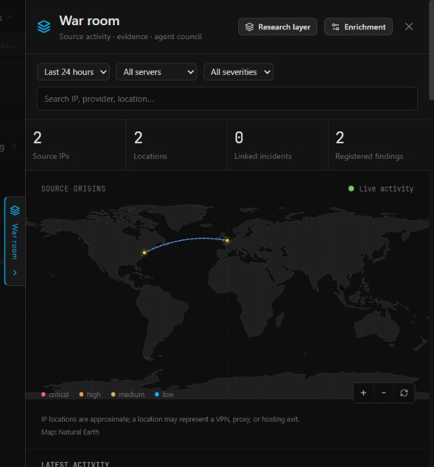
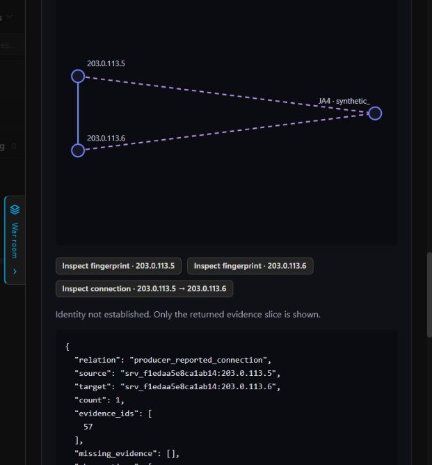

# Behavioral research prototype

This experimental module is the first implementation slice of KodeBlue's
behavioral intelligence layer. It adds passive analytics/evidence storage,
deterministic daily counts, a bounded relationship graph and a research layer
inside the existing War room. It does not change existing agent procedures,
run a new model, issue containment actions or deploy anything to a reference site.

## Run and configure

Start the hub with `--behavioral-research`, or set
`KODEBLUE_HUB_BEHAVIORAL_RESEARCH=1`. The module is off by default and creates
`<hub-data>/research/research.db` only when explicitly enabled. It uses no external
analytics service or model. Existing agent API keys authenticate trusted producers;
operator cookie sessions and CSRF protect configuration. A server key does not
grant research read access or access to another site's ingestion.

Open **War room → Research layer**, or **War room · research** in the user menu.
Create a site with a name, IANA timezone, exact allowed browser origins, optional
allowlisted browser paths and explicitly selected enrolled server IDs. Website,
source and fingerprint names are not identities of people.

The geographic map keeps its existing source filters, pan/zoom, incident inspector
and enrichment consent. The research layer reuses locations already available in
that view. It never starts another IP lookup. Solid relationship lines represent
producer-reported connections; dashed links represent shared fingerprints. Missing
locations remain in the non-geographic graph rather than being invented. The
daily report covers its selected site/calendar day; geographic relationships also
follow War room's time/server filters. Those scopes are intentionally visible.

The following development screenshots use documentation-range IPs and synthetic
locations and observations. No live provider lookup or model produced this data.





## Event contract

Trusted source ingestion:

```http
POST /api/agent/v1/research/{site_id}
Authorization: Bearer <existing enrolled server key>
Content-Type: application/json
```

```json
{
  "events": [{
    "id": "unique-source-record-id",
    "at": "2026-10-31T10:00:00Z",
    "kind": "request",
    "path": "/.env",
    "method": "GET",
    "status": 404,
    "peer_ip": "203.0.113.5",
    "fingerprint": {
      "algorithm": "ja4",
      "version": "1",
      "value": "producer_supplied_signature",
      "capture_point": "client_ingress"
    }
  }]
}
```

The source ID comes from authentication, not the body. Maximum 32 observations
and 64 KiB per trusted batch. Source IDs and event IDs form an idempotency key.
An accepted receipt commits the aggregate and retry key; detailed rows can already
be evicted under capacity pressure, reflected in the receipt and coverage counters.
Repeated requests with different source record IDs are not deduplicated by content.

`connection` requires `peer_ip` and `destination_ip`. Explicit connection events
are the only observations rendered as network communications. Optional fingerprints
carry algorithm, version and capture point. This prototype accepts producer values;
it neither computes JA3/JA4 nor obtains unavailable provider fields. Metadata says
`enrolled_source_reported`, not independently verified. Original visitor TLS
fingerprints require an actual client-facing capture point; a CDN/backend hop
must not be relabeled as the visitor.

Events outside the detail window or over five minutes in the future are rejected.
Source event time and hub observation time are exposed separately. Paths lose
queries/fragments and common embedded secrets; source adapters still need their
deployment-specific redaction policy. Arbitrary request bodies, headers, cookies,
UAs and event-property dictionaries are not accepted by this contract.

## Optional browser SDK

Serve `/research-tracker.js` from the hub or proxy it through the website. Integrate
it through the site's approved privacy policy, not by silently adding it to pages.
Example website code after loading the script:

```js
window.kodeblueAnalytics.start({
  site: 'website-prod',
  endpoint: 'https://hub.example.com/collect/research/website-prod',
  permitted: () => siteAnalyticsPermissionIsGranted(),
});
window.kodeblueAnalytics.track('pageview');
// Example: call only on the actual interaction; never send contact/form values.
window.kodeblueAnalytics.track('interaction', 'booking_intent');
```

The permission callback must explicitly return true. DNT/GPC suppress collection;
`start` itself sends nothing. The SDK has no cookie, persistent visitor ID, device
challenge or active browser fingerprinting. Each event gets a fresh UUID. It makes
one delivery attempt and returns the server's stored status, without retrying an
unknown outcome. Only predefined interaction/performance names are accepted.

Browser ingestion is public, origin-restricted and separately throttled. Origin
matching is not authentication; events remain `browser_claimed`. They cannot set
peer addresses, methods/statuses, source identity or fingerprints. Unknown browser
paths become `/:other`; only `/` and the site's explicit path allowlist retain path
names. Query/hash values are never stored. A recorded pageview is not proof of a
human visitor, JS execution, a real click, malicious intent or an AI agent.

## Storage and query budgets

Prototype defaults, to be revisited with representative load tests:

| Budget | Default |
| --- | --- |
| Research DB/journal envelope | 256 MiB; DB page allocation capped at one third |
| Detailed observations | 50,000 globally; 10,000 per site; up to 72 hours |
| Retry receipts | 200,000 globally; at most 150,000 from browsers; detail TTL + 5 minutes |
| Aggregate buckets | 20,000; up to 30 days; fixed dimensions and 15-minute intervals |
| Site registry | 64 sites; 32 enrolled sources, 8 origins and 32 browser paths per site |
| Ingestion | 120 batches/minute per source or browser network key; 600/minute per traffic class globally |
| Concurrent ingest | 4 admitted operations; excess receives a visible busy response |
| Evidence page | 100 rows with insertion-order keyset cursor |
| Graph | Latest retained page; capped links/nodes and at most 8 evidence IDs per grouped edge |
| HTTP query deadline | 2 seconds |

SQLite rollback-journal mode is deliberately used for this bounded foundation,
with a separate connection/database from incident state. Page limits reserve room
for rollback files; temporary query work is in memory, the SQLite cache is bounded,
and no large VACUUM is run. Minute maintenance expires records and incrementally
reclaims reusable pages. Detail eviction prefers browser data over producer evidence.
Browser receipts have a ceiling that reserves space for producer retry keys.

Aggregate dimensions exclude arbitrary paths, IPs, UAs and fingerprint values.
There is no unbounded per-value dictionary, full-payload index, saved-report archive
or background all-pairs graph construction. Compaction retains counts, not missing
evidence. Daily totals can survive detail eviction; that does not justify a strong
historical attribution. At receipt/page capacity ingestion fails visibly rather
than resetting retry history and double counting. Production ingest capacity and
maintenance peaks remain to be established by realistic sustained-load tests.

Disabling the module stops recording and maintenance; it does not erase its files.
Ordinary server deletion does not erase research history as a side effect.
Historical observations expire through the research retention policy while enabled.
Explicit research-site deletion is a separate authenticated operation and deletes
that site's research records. It is not performed automatically by agents.

## Reports and confidence

Authenticated operator endpoints:

- `GET /api/research`: enabled state, sites and physical file bytes.
- `PUT|DELETE /api/research/sites/{site}`: explicit site configuration/lifecycle.
- `GET /api/research/sites/{site}/events?after=0`: bounded evidence page.
- `GET /api/research/sites/{site}/events?tail=1`: latest retained evidence slice.
- `GET /api/research/sites/{site}/daily?date=YYYY-MM-DD`: deterministic daily overview.
- `GET /api/research/sites/{site}/graph`: bounded, typed evidence relationships.

Reports distinguish request counts from browser pageviews/interactions. They use
the configured local calendar day, including DST and quarter-hour timezones. The
baseline is explicitly unavailable until validated comparable-day logic is added.
The initial sensitive-route-volume check reports `needs_review` at 20 requests;
it never declares an actor, maliciousness or compromise, and does not wake a model.
Counts are observations received by this module, not a promise that upstream
traffic was fully captured. Coverage includes lifetime acceptance/rejection and
capacity-loss counters, retention limits and known interpretation limitations.

## Investigator and War room council contract

The following is the next integration stage, **not enabled in this prototype**.

War room is the shared workspace for the full picture: geographic sources,
relationship map, timeline, evidence references and specialist discussion. The
admin chairs the council. The investigator connects cross-source facts; responders
own their incidents; the learner supplies baseline/environment context; the reviewer
checks drift and coverage. Existing agents keep their core procedures and tools.

The coordinator reads saved reports first and invokes only relevant participants
for a requested report, a qualifying traffic finding or an explicit admin question.
No permanent agent-to-agent conversation or automatic broadcast on every event.
Requests coalesce by scope/question/evidence version and obey concurrency, token,
time and query budgets. Missing or busy participants are visible rather than
represented by invented answers.

The investigator must be registered through KodeBlue's native agent catalog and
session lifecycle, using the normal model configuration, session/status display,
cost accounting, cancellation and notification path. It is not a separate bot
application, window, roster or notification service. Council participant metadata
extends that same catalog with specialty, permitted evidence scopes, supported
questions, wake conditions, response schema and budgets. It does not grant access
just because an agent appears on the roster, and adding another native agent must
not require edits to every existing agent prompt. The coordinator sends research
notifications through existing delivery/deduplication rather than adding another
direct alert path or granting a read-only investigator unrestricted send tools.

Council phases:

1. **Picture:** assemble observed facts, cited specialist views, disagreements,
   coverage and unanswered questions. Agreement is not independent corroboration.
2. **Response discussion:** create a versioned proposal containing exact actions,
   targets, supporting evidence, expected benefit, risks, expiry and policy limits.
3. **Advisory ballots:** each invited participant records support, oppose,
   conditional support or abstain, citing evidence and its own specialty. Pending
   participants do not count as votes; shared underlying evidence is identified.
4. **Admin decision:** only the signed-in admin can approve/reject a specific
   proposal version. Changing its action, target or evidence invalidates that
   version's approval and requires a fresh decision. Votes never execute anything.
5. **Policy-controlled execution:** an approved proposal enters the existing
   response approval/execution path. Root policy still applies; the council cannot
   bypass disabled actions or protected targets. Record outcome and return it to
   the council's evidence timeline.

This module does not change existing automatic-response policies. Any future
change to those policies needs a separate explicit product decision. The
investigator itself has no containment, incident-resolution, monitor/rule/profile
mutation, raw container-control or secret-reading tools.

## Remaining work before a production feature

- Passive adapters for gateway/workload streams; no existing tap is silently
  forwarded by this prototype.
- Read-only investigator broker, scoped job grants, lifecycle/billing/cancellation
  and the extensible participant registry/council routing.
- Advisory ballots, admin proposal-version approval and existing-policy handoff.
- Validated sequence/recurrence rules, comparable-day baselines, query usefulness
  measurement and precision/abstention evaluation on held-out scenarios.
- Scheduled daily delivery, coalesced traffic triggers and model-budget controls.
- Capture-point-specific passive fingerprint sensors and provider capability checks.
- Production load/storage tests and a broader privacy/security review.

No claim of 99% correlation precision is made by this prototype. It stores and
visualizes scoped observations and emits research leads with explicit limits.
