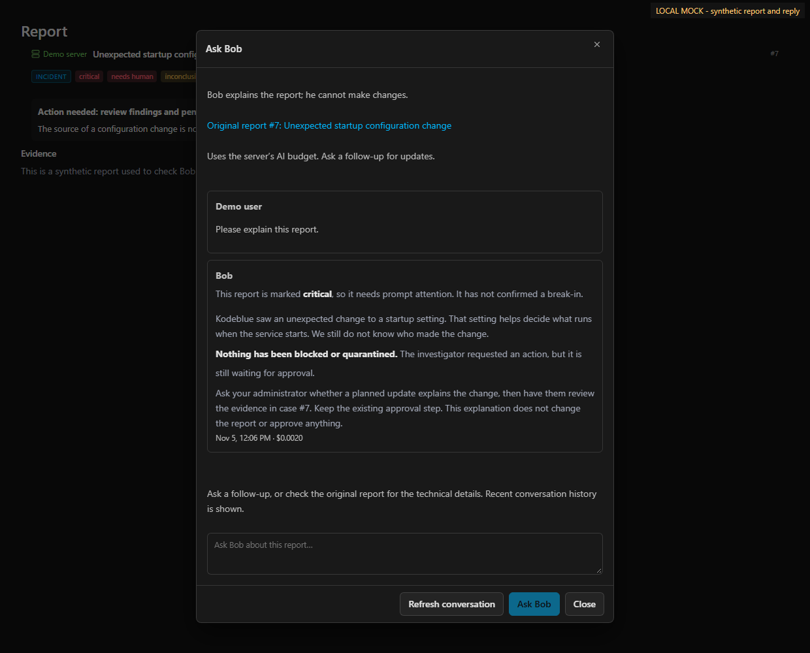

# Ask Bob

Bob is a security teammate who explains reports in everyday language. Open a
case on the hub and choose **Ask Bob** in its header. The first visit requests
an explanation immediately. Ask follow-up questions in the dialog, or return to
the original report using its link. Reopening an existing conversation shows
recent answers without requesting another explanation automatically.

Bob explains what happened, what is confirmed or uncertain, what Kodeblue
actually did and whether the report asks someone to act. He preserves the
source's severity and approval requirements. A request to block something is
not a completed block; an inconclusive report is not an all-clear. Answers are
dated, and follow-ups use the current source report. Bob is not a replacement
for the investigator or an authorized administrator.

The screenshot is a local mock with synthetic report text and a scripted reply,
not a real-model quality evaluation.

## Permissions and model use

Bob has a separate agent definition and session with an explicit read-only
tool list. He can retrieve cases, findings, monitoring/coverage information,
vulnerabilities and recorded response requests. He has no host command,
file-writing, monitor-editing, approval, containment or incident-resolution
tools. He never continues the investigator's action-capable session or changes
the original case. Questions and answers use the existing authenticated hub
message transport. The source report and conversation cannot be switched by
reusing a conversation ID.

Existing hub sign-in is required. Bob does not introduce a public chat endpoint,
viewer accounts or new user permissions: the human still has their existing hub
operator access. The read-only restriction applies to Bob's agent capabilities.

Bob uses the existing **Operator** model/provider selection and shared model
budget checks. Turns are recorded under the `bob` spend purpose. No API key,
model connection, listener or scheduled job is added. Bob shares
`hub.accept_messages` and `hub.messages_per_hour`; turning messages off or
exhausting the shared rate limit also prevents Bob requests. Each turn has at
most 12 agent iterations and a two-minute wait deadline. These bounds do not
constitute a separate hard dollar cap; the existing budget/accounting rules
still apply. Closing the dialog stops polling, not the server's queued work.

## Availability and failure behavior

An updated agent must advertise `accepts_bob`. An older agent, disabled messages,
or unavailable model leaves Ask Bob disabled with an explanation. The dedicated
POST endpoint also fails closed on older hubs; it never falls back to ordinary
operator chat. Reports no longer present on the server cannot be explained.

Queued questions remain visible while the server is offline or busy. The UI
prevents sending another question while one is pending. If delivery cannot be
confirmed, it keeps the draft and requires a history refresh before retrying.
Failed, refused, partial and empty responses are shown as unsuccessful. A
confirmed missing Bob session can restart only as a fresh read-only Bob session,
with an explicit notice that earlier conversation context is unavailable.
Other runtime failures do not silently start another session.

The dialog displays up to 50 recent messages for the source case, selecting
the latest Bob conversation. History and model sessions use existing retention;
this is not an indefinite archive. Bob sees report summaries and relevant
recorded evidence, not live omniscience. His instructions preserve uncertainty
and reject embedded instructions in host data, but model wording and factual
quality still require evaluation; tool restrictions do not guarantee a perfect
explanation. Daily lessons and recurring notifications are deferred.

## API and tests

Authenticated, CSRF-protected `POST /api/servers/{id}/bob` accepts `body` (1–8000
UTF-8 bytes), `incident_id` and optional `conversation_id`. It queues a `bob`
message. Read recent history with
`GET /api/servers/{id}/messages?bob_incident_id={case-id}`. Existing operator
chat and action endpoints retain their existing behavior. Both hub and agent
validate source/conversation scope; the agent stores its session separately
from operator conversation keys. Bob does not create a second incident on the
board or alter the source case's pending/approval state.
Bob history is kept out of ordinary board/server conversation lists so it does
not consume their history limits. Signing out closes Bob and clears its polling.

Tests cover read-only tool registration, role/session isolation, unchanged source
cases, budget and message limits, source/context rejection, first-turn and
follow-up accounting, explicit missing-session recovery, partial/empty answers,
authentication/CSRF/capability checks and UI network/pending states. Desktop and
phone layouts are checked against synthetic local replies. No production
deployment or measured real-model comprehension improvement is implied.
