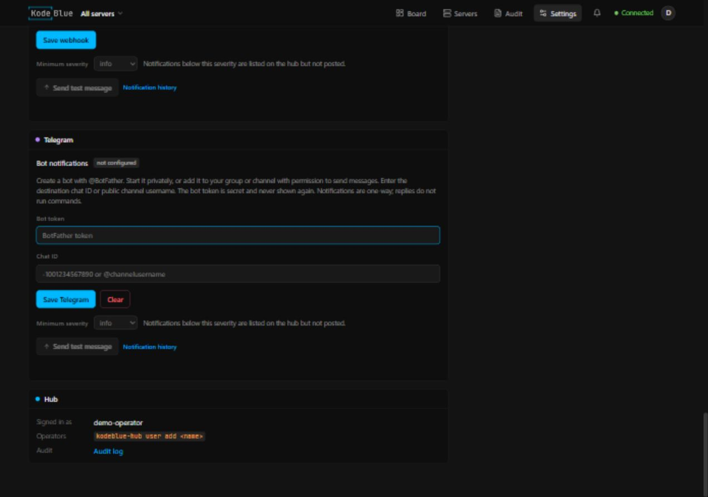

# kodeblue hub

The hub is the central console for a fleet of kodeblue servers. Operators sign in and see, per server:

| Tab | What it shows |
|---|---|
| **Board** | the server's cases as cards in three columns (Investigating, Needs human, Resolved): incidents, learning runs, reviews and operator conversations. A card opens a **case panel** with the summary, the report, the **agent's self-evaluation**, linked findings and containment actions, and the **full agent session**: its reasoning ("Thinking"), what it said, and every tool call with arguments and result. Running sessions stream live, every ~5 s. The panel's composer messages the agents (see below). **Filters** above the columns narrow the board by severity, type, server (on the fleet board), pinned cases or what needs you (approvals and Needs human); each browser remembers its own. **Pin** a card (its pin button, the right-click menu, or several selected cards) to keep it at the top of its column for every operator until someone unpins it |
| **Overview** | phase (learning / watching / maintenance), response policy, models, spend vs budget, the server profile the learner wrote, open cases, agents working right now, latest activity; **Run learner** and **Relearn** buttons (see below) |
| **Vulnerabilities** | everything known to be weak on the server in one list (the hub's view of its `VULNERABILITIES.md`): open ones by severity, each with its service, CVEs, evidence, how to fix it and whether its check passes; filters by status, severity and service, and a search; **Accept risk** (with a reason), **Reopen** and **Recheck now**. Below it, the daily software check: OS support, security updates waiting and new CVEs from the feed that name software on the server. The tab badge counts open vulnerabilities |
| **Auto-block** | the **containment rules**: what kodeblue does by itself once you approve it, for attacks that keep coming back (see below). Each rule shows what it does, why the agent proposed it, how often it fired and when it expires, with Approve, Reject, Pause and Delete; below them, every action the rules took. The tab badge counts rules waiting for approval |
| **Services** | the service inventory: each service's ports, monitoring coverage and its own vulnerabilities |
| **Findings & triage** | what the sensors flagged, the triage model's verdict and one-line reasoning for each, evidence on click, and which ones wait for `kodeblue ack` |
| **Monitors** | the monitors the agents wrote (check, interval, ok/failing, runs, last output), the built-in sensors and their sweep counts, allow rules with hit counts. Monitors only raise findings; they never act |
| **Self-evaluation** | the reviewer's periodic self-score and write-up, each case's self-evaluation and confidence, false-positive rate, and the 7-day findings-by-rule outcome table |
| **Activity** | containment actions taken, actions waiting for approval (with the exact `kodeblue respond approve` command), and the journal of every automatic decision |
| **Knowledge** | the reports, skills and definitions the agents wrote on the server |
| **Notifications** | everything this server sent to Slack, with delivery status |
| **Settings** | this server's overrides of the fleet's agent settings (models, instructions, approval rules), and whether the server has applied them |

Plus fleet-wide **Notifications**, **Settings** (model connections: an inference manager, OpenRouter, any OpenAI-compatible API; a model per agent from any of them; agent instructions; containment approval rules; the fleet's Slack channel and its minimum severity, with a test button; keys and the webhook are never shown back), a **Servers** view (online/offline, phase, open incidents by severity, what needs a human, failing monitors, spend) and a hub **audit log** (sign-ins, servers added/revoked, enrollments, every message sent).

## Connection and security model

```
server (kodeblue, its own user)                          hub
  kodeblue enroll ──── one-time token (kbe_…) ─────────► POST /api/agent/v1/enroll
                  ◄─── this server's API key (kbk_…) ───
  sync every 15 s (5 s while an agent works) ──────────► POST /api/agent/v1/sync      Authorization: Bearer kbk_…
  long-poll for operator messages ─────────────────────► GET  /api/agent/v1/messages
  reply when the agent session finishes ───────────────► POST /api/agent/v1/messages/{id}/reply
```

- **Servers dial out; the hub never connects to a server.** Nothing on a server listens for the hub, so a compromised hub cannot reach into servers except through the messages channel below.
- **One-time enrollment.** "Add server" creates a single-use token that expires (default 2 h). The installer trades it for the server's own API key. Reusing a token fails, including two concurrent attempts. A new token for an existing server rotates its key and cancels any unused token; **Revoke** cuts it off at once. The token is in the install line you paste, so keep that line out of your shell history ([deploy.md](deploy.md#keep-the-token-out-of-your-shell-history)).
- **Only hashes are stored.** The hub keeps SHA-256 hashes of enrollment tokens, server keys and web-session tokens. Operator passwords are PBKDF2-SHA256 (600k iterations).
- **TLS everywhere.** The agent refuses a non-https hub (except loopback). Choose one of:
  - a real certificate (`--tls-cert/--tls-key`)
  - a reverse proxy that terminates TLS (`--behind-proxy`)
  - `--self-signed`: the hub generates a key and servers **pin its public key** (`--pin sha256//…`, curl's `--pinnedpubkey` format). That gives full man-in-the-middle protection without a CA or a domain. The install command the hub prints includes the pin.
- **Each server sees only itself.** A server key can only write its own records and answer its own messages. Unknown record kinds are dropped, and bodies and records are size-capped.
- **Browser hardening.**
  - Strict CSP: no inline script or style, no third-party origins, no framing.
  - `SameSite=Strict`, `HttpOnly` (and `Secure`/`__Host-` over TLS) session cookie.
  - A per-session CSRF token on every state change, compared in constant time.
  - Sign-in throttling: 8 failures per client address (an IPv6 /64 counts as one address) and 24 per user name from anywhere, per 15 min. A browser that user signed in from before (a signed, HttpOnly device cookie, kept 180 days) is exempt from the per-user limit, so guesses from elsewhere cannot lock that operator out. Each attempt is counted before the password is checked, so concurrent guesses get no more tries than sequential ones. The hub runs only a few password checks at once (half the CPUs, plus one slot only known browsers can use); past that a sign-in waits up to 2 s, then gets `503`, so a flood of sign-ins cannot starve syncs, the console, or an operator's usual browser. Behind a proxy, `X-Forwarded-For` counts only from `--trusted-proxy` addresses (default loopback), so a client cannot spoof its address.
  - Optional `--console-allow`: the console and operator API answer 404 to addresses outside the list; servers can always enroll and sync.
  - Everything a server sends is treated as attacker-controllable: the console renders it only as text, never as HTML.
- **Installer downloads need a credential.** The release tarballs are served only to a live enrollment token, a server key (upgrades) or a signed-in operator. `install.sh` itself holds no secrets.
- **Pinned release hashes.** The install command the console prints carries the sha256 of the `install.sh` the hub serves and checks it before running it as root. That `install.sh` carries the sha256 of each agent tarball (written in by the hub as `KODEBLUE_DIST_SHA256SUMS`), and the installer checks the download against it instead of fetching `SHA256SUMS`. The hub takes these hashes once, when it first needs an installer (it keeps looking until one is published), and keeps them until it restarts. Restart the hub after updating its release files; `kodeblue-hub server add` (a separate process) hashes the files as they are now, so run it only after that restart. A release file swapped under a running hub, with or without a matching `SHA256SUMS`, then fails the check instead of being installed. A tarball that disagrees with `SHA256SUMS` at that moment is not pinned at all, and installs of it fail. Upgrading the hub restarts it.
- **The hub's own outbound calls** (the model connection test, the model browser, and Slack posts and the Slack test button) refuse loopback, link-local (`169.254.0.0/16`, `fe80::/10`, the metadata service of every major cloud), `fd00:ec2::254`, `100.100.100.200`, unspecified and multicast addresses, whatever a name resolves to. They also do not follow redirects to another host and do not use `HTTPS_PROXY`. Private LAN ranges (`10/8`, `172.16/12`, `192.168/16`, `100.64/10`, `fc00::/7`) stay allowed, because self-hosted gateways live there. For an endpoint on the hub's own host, allow it with `--endpoint-allow 127.0.0.1` (`KODEBLUE_HUB_ENDPOINT_ALLOW`). Servers reach their model endpoints themselves, so a connection such as `http://127.0.0.1:11434` (a model on each server) still works for them.

### What operators can and cannot do from the hub

Operators can **message** a server's agents. A message about an idle incident can continue its session. Input to an operator-owned running session is steered between actions; live responder, learner, reviewer and decisions sessions keep their own waiters and receive questions through a separate operator-liaison session. Anything else starts an operator-liaison session (`blue-operator`) per conversation. The agent can investigate, explain, add or tune monitors and allow rules, update the profile, definitions and skills, and *request* containment.

If this conversation's operator agent is thinking or working, a new message steers that same
session. Running tools finish before the new input is delivered at the next safe
boundary; the agent then continues with the updated context. Rapid messages are
admitted in order, and the conversation remains active until its continuation
finishes. An idle session receives an ordinary follow-up.

Operators can also **approve or deny** containment an agent requested in `recommend` mode, from the case or the server's Activity tab. The hub only relays the ruling. The server checks the request is still pending (the agent's own request, unchanged), then runs it through the root helper under the root-owned `/etc/kodeblue/kodeblue.toml`, so the policy's allowed actions, protected users, IPs and units, and rate limit still apply. Every ruling is in the hub audit log, the server journal and Slack. On the server the same is `kodeblue respond approve <id>` / `kodeblue respond deny <id>`. A case with several requests has **Approve all**, and its "Waiting for your approval" block folds away (it opens again when the agent asks for something new). The agent never runs actions itself: once nothing waits for a ruling any more, the server hands the incident's agent what was approved, what ran and what was denied, and it checks the result, then resolves the case or says what still needs a human. Approvals made on the server's CLI reach it on the next triage tick.

Operators can also **start learning** from the server's Overview (Learning row). As with a ruling, the hub only relays the request and the server starts the run itself:
- **Run learner**: the `blue-learner` agent reviews the baseline the server already has and writes or updates the profile, definitions, monitors and skills. Detection keeps running. Use it after picking models for a server that learned without them, or to refresh what the learner left.
- **Relearn**: the whole learning phase again (baseline sweeps over `learning_minutes`, then the learner). Everything the server runs during the sweeps is absorbed as normal, so relearn after planned changes, never while you suspect a compromise.

Operators can also **rule on containment rules** on the server's **Auto-block** tab. For an attack that keeps coming back, an agent proposes a rule such as "block every address that brute-forces SSH"; it does nothing until approved. Approving shows the rule in full and relays the hash of exactly what was shown; the server's root helper checks it and keeps the approved copy. An approved rule acts without asking, so the server takes an approval from the hub only where its root allowed automatic actions from the hub (`accept_approvals`, and `[response] mode` or `hub_max_mode` = `contain`); elsewhere the hub shows the `sudo kodeblue rules approve <id>` command instead. Reject, Pause (both with a reason) and Delete are relayed the same way. The tab badge, and a badge in the Servers view, count rules waiting for approval. Details in [kodeblue.md](kodeblue.md#containment-rules).

One learning run at a time per server. Every run is in the hub audit log, the server journal and Slack. On the server the same is `kodeblue relearn && systemctl restart kodeblue`.

Operators can also **configure the agents** (Settings for the fleet, and a Settings tab per server that overrides single entries):
- **model connections**, several side by side:
  - an **inference manager**: a gateway that serves several vendors and lists each model's vendor (`provider`) in `/v1/models`
  - **OpenRouter** (`https://openrouter.ai/api` and a key)
  - any **OpenAI-compatible** API (`{base}/v1/chat/completions` and `{base}/v1/models`: vLLM, Ollama, LiteLLM, a cloud vendor)
- a model per role from any connection, picked in one searchable model browser across all of them (with context length and prices where the connection publishes them): default, triage, learner, responder, reviewer, operator, and critical incidents. For example triage on the inference manager and the responder on OpenRouter
- extra instructions for all agents or one of them, added after the agent's built-in prompt
- per containment action: **needs approval**, **automatic** or **off**
- the **response mode** (off, recommend, contain), per server: lower than the server's own `[response] mode` at any time, and higher only up to its root-owned `[response] hub_max_mode`. A server opts in with `hub_max_mode = "contain"` (the installer's `--hub-max-mode contain`, or the checkbox in Add server); every change of mode is announced in Slack and the server journal
- **server settings**: the daily model budget (and model prices for endpoints that report no cost), how many incidents run at once and per hour, steps per investigation, how often the reviewer runs, the baseline's length and snapshots, retention, re-alert interval, brute-force threshold, debounce, the lowest severity that notifies, agent messages per hour, the hub sync interval and chat rate, transcript sharing, and the daily CVE feed with each of its sources (NIST NVD, CISA Known Exploited Vulnerabilities; a server keeps off what its own `[cve_feed]` turns off). Each has bounds (a brute-force threshold of at most 50, retention of at least 7 days, a sync every 5 to 300 seconds). Settings that decide what a server sees, reports or keeps only tighten: the server takes the hub's value only when it is stricter than its own (a lower brute-force threshold, debounce, re-alert interval, notification severity or chat rate; longer retention; higher model prices; transcript sharing turned off, never on). A server never takes a daily budget above its own `[budget] hub_max_daily_usd` ($20 unless set; with `0` the hub may only lower `daily_usd`)
- **protected users, IPs and services**, added to each server's own lists (never in place of them), and a lower **containment actions per hour** limit

Connection keys stay in the hub database and are never shown back. Because an operator cannot see a stored key, the key never follows a connection to another endpoint: changing the base URL's scheme, host or port needs the key entered again (a path change on the same host keeps it). Every URL change is in the audit log with the old and new URL, and so is a refused one. A server receives only the connections its roles use, with their keys, and keeps them in its state directory (0600). A connection that a model is picked on cannot be removed until other models are chosen.

Servers pick settings up on their next sync and restart kodeblue to apply them once no agent session is running, at most once every 5 minutes (detection state that builds over sweeps lives in memory), also between the baseline snapshots of a first learning run (the baseline resumes where it left off, keeping its interval between snapshots). The server's Settings tab shows whether they are applied, and each server setting shows the value the server runs ("now").

While a server learns, its page and the Servers list show how far the baseline is (snapshot 7 of 10, the last around 01:35), and whether the model the learning session needs is on the server, on its way from the hub, or missing.

The hub **cannot** loosen a server's policy or create containment of its own. Approval rules only tighten the root-owned `[response]` policy, and the root helper never reads them:
- an action is automatic only where the server runs `contain`: its own policy says `mode = "contain"`, or root set `hub_max_mode = "contain"` and an operator switched it to contain here. In the default `recommend` mode everything still needs a human
- in `off` mode, or for an action outside `allowed_actions`, nothing runs
- protected detections still need `kodeblue ack` on the server
- protected users, IPs and services from the hub only add to the server's own, and the hub's containment limit only lowers the server's; agents' requests are checked against both before they reach the root helper, which applies the server's own
- server settings cannot turn off detectors, lower the confidence that auto-accepts a finding as benign, or change the opt-outs below

A stolen hub session can therefore approve containment an agent asked for, point the agents at another model endpoint, give them instructions, relearn a server (announced in Slack), start an upgrade to the hub's version (only a newer, published release, downloaded and checked by the server itself) or mark a vulnerability as an accepted risk (journaled on the server with the operator's name and reason), but not make a server act on its own, unless that server's root set `hub_max_mode = "contain"`, which lets the hub switch it to contain. Instructions cannot widen what agents may do either: their tools, the response policy and the protected users, IPs and units stay as the server configures them. Servers where that is too much set `accept_approvals = false`, `accept_settings = false`, `accept_learning = false` and `accept_upgrades = false`.

A server can opt out entirely, or limit what the hub sees, in `[hub]`:
- `accept_approvals = false`: approve/deny, and approving or deleting containment rules, only on the server
- `accept_settings = false`: the console's model, instruction and approval settings are ignored
- `accept_learning = false`: learning and relearning only on the server
- `accept_upgrades = false`: upgrades only on the server (`sudo kodeblue upgrade <version>`)
- `accept_messages = false`: no remote instructions, and vulnerabilities can be accepted, reopened or rechecked only by the server's agents and kodeblue itself
- `share_transcripts = false`: no agent reasoning or tool output leaves the server
- `messages_per_hour`: rate limit (default 20)

Operator sessions count against the server's daily model budget.

Changes an agent makes while answering an operator (allow rules, monitors, profile, containment requests) and every maintenance window are posted to Slack. Because the hub owns Slack, a fully compromised hub could suppress those posts. For servers where that matters, set `[notify] direct = true` with a local webhook: the server then also posts on its own, and the hub cannot stop it.

## Running the hub

This section is a summary. Full instructions (reverse proxy examples, upgrades, backups) are in [deploy.md](deploy.md); locking the hub down (firewall, WireGuard, keys, accounts) is in [hardening.md](hardening.md).

### Docker (behind a TLS proxy)

```bash
docker build -f deploy/hub/Dockerfile -t kodeblue-hub .
docker run -d --name kodeblue-hub -v kodeblue-hub:/data -p 127.0.0.1:8080:8080 \
  -e KODEBLUE_HUB_PUBLIC_URL=https://hub.example.com -e KODEBLUE_HUB_BEHIND_PROXY=1 -e KODEBLUE_HUB_LISTEN=:8080 \
  -e KODEBLUE_HUB_TRUSTED_PROXIES=172.16.0.0/12 kodeblue-hub
docker exec -it kodeblue-hub kodeblue-hub user add admin
```

The image builds the agent release (amd64 and arm64) into `/opt/kodeblue-hub/dist`, so the hub can serve installs on its own. In `--behind-proxy` mode the hub speaks plain HTTP, so publish the port only where the proxy can reach it (here: loopback). Inside the container the proxy's connections come from the Docker bridge, not loopback, so `KODEBLUE_HUB_TRUSTED_PROXIES` must cover the bridge subnet; otherwise `X-Forwarded-For` is ignored and every client looks like the bridge gateway.

### A plain Linux host

```bash
deploy/build-dist.sh dist                     # agent tarballs + hub bundles
scp dist/kodeblue-hub-linux-amd64.tar.gz hub:
ssh -t hub 'tar xzf kodeblue-hub-linux-amd64.tar.gz && sudo kodeblue-hub/install-hub.sh --public-url https://hub.example.com:8443 --self-signed'
```

`install-hub.sh` sets up:
- the `kodeblue-hub` user
- `/var/lib/kodeblue-hub`
- a hardened systemd unit
- the first operator account (it prompts for the password)

With `--self-signed` it prints the certificate pin.

**Console over an SSH tunnel:** `--http-listen 127.0.0.1:8080` (or `KODEBLUE_HUB_HTTP_LISTEN`) adds a plain-HTTP listener on loopback, then `ssh -L 8080:127.0.0.1:8080 hub` and open `http://localhost:8080`. It is refused on any non-loopback address. It serves the same routes as the main listener. To keep the console off the internet, use `--console-allow` (it applies on this listener too, so include `127.0.0.1`); see [hardening.md](hardening.md#keep-the-console-off-the-public-internet). `install-hub.sh` takes `--http-listen`, `--console-allow` and `--trusted-proxy` as well.

### Slack

The hub owns the fleet's Slack channel. Set it in **Settings** or with `kodeblue-hub fleet set slack-webhook` (value on stdin).
- **Delivery:** servers queue their notifications and ship them with each sync. The hub stores each one once (re-sent batches are de-duplicated) and posts it under the name *the hub* gives the server, so one server cannot post as another.
- **Retries:** failures retry with backoff (1 to 32 minutes, 8 attempts).
- **Minimum severity:** notifications below the setting are kept on the hub but not posted.

Servers never receive the webhook. A server that should also post on its own, as an independent channel, can set `[notify] direct = true`.

### Telegram

Telegram can be used instead of Slack or alongside it. In **Settings → Telegram**,
enter a bot token and destination chat ID, save, and send a test message.

1. Create a bot with [@BotFather](https://t.me/BotFather) and keep its token secret.
2. For private messages, open the bot and press **Start**. For a group, add the bot;
   for a channel, add it as an administrator with permission to post messages.
3. Use the numeric destination chat ID (groups often start with `-100`), or the
   `@channelusername` of a public channel. For a private chat or group, send a
   message there and inspect `getUpdates` using the official
   [Bot API](https://core.telegram.org/bots/api#getupdates) from a trusted local
   client. Do not paste a token into a third-party chat-ID lookup service.

The token is stored only on the hub and never returned by the settings API,
shown in the console, or handed to enrolled servers. CLI setup is also available;
values are read from stdin without echo:

```bash
kodeblue-hub fleet set telegram-bot-token
kodeblue-hub fleet set telegram-chat-id
```

Telegram has its own minimum severity setting. Each destination retries independently
(exponential backoff, at most 8 attempts; permanent Telegram errors fail immediately and flood-control retry_after is honored), so a Telegram failure does not resend a
successful Slack delivery. Notification history summarizes all destinations: it stays
pending while any delivery is pending, then reports failure if any destination failed.
Changing settings applies to pending and future notifications; historical skipped or
completed deliveries are not replayed. Messages use an explicit preformatted entity with link previews disabled. IPs,
paths and addresses remain copyable without inserted invisible characters.
Standalone sends run destinations concurrently; acceptance by any destination
counts as success, while other failures are logged. Use hub delivery when each
destination needs durable independent retries.

The hub exposes separate save, clear, minimum-severity and test-message controls
for Telegram. This local preview has no bot token or chat configured.



### Fleet defaults

So a server can be installed with one command, the hub hands the fleet's default model, its connection and that connection's key to new servers at enrollment. The other roles' models follow on the first sync. Set them in **Settings**, or set one connection (it appears as "Default") on the hub host:

```bash
kodeblue-hub fleet set inference-url        # e.g. https://api.example.com (value on stdin)
kodeblue-hub fleet set inference-model
kodeblue-hub fleet set inference-key
kodeblue-hub fleet set inference-provider   # optional routing label, for gateways that serve several vendors
kodeblue-hub fleet status
```

The key and the Slack webhook live in the hub database (0600, in a 0700 directory) and are never printed back.

## Installing a server

In the console, **Add server** gives you the command. Run it on the server:

```bash
f=$(mktemp) && r=$([ "$(id -u)" = 0 ] || echo sudo) && { curl -fsSL --proto =https --proto-redir =https -o "$f" https://hub.example.com/install.sh && echo "<sha256>  $f" | sha256sum -c - && printf '%s\n' kbe_… | $r sh "$f" --hub https://hub.example.com --token-file -; s=$?; rm -f "$f"; (exit "$s"); }
```

The command checks `install.sh` against the hash the hub pinned (`<sha256>`) before running it as root.

The installer:
1. downloads the release and verifies it against the hashes pinned in the script
2. creates the `kodeblue` user, the directories and the systemd units (main service + socket-activated root response helper)
3. writes the example policy in `recommend` mode
4. enrolls
5. asks for a model endpoint, model and key if neither the flags nor the hub provided them
6. starts kodeblue

Useful flags:

| Flag | Effect |
|---|---|
| `--pin sha256//…` | the hub's certificate pin, for a self-signed hub (the printed command includes it) |
| `--ca-file` | CA certificate that signed the hub's certificate, for a private CA |
| `--name` | the server's name in its own config (the hub shows the name given in **Add server**) |
| `--mode off\|recommend\|contain` | response policy for a new install |
| `--inference-url`, `--model` | the model endpoint (any OpenAI-compatible API) and model |
| `--inference-key-file` | read the endpoint's API key from a file |
| `--slack-webhook-file` | only for servers without a hub |
| `--telegram-bot-token-file`, `--telegram-chat-id-file` | only for servers without a hub |
| `--no-start` | install without starting |
| `--uninstall [--purge]` | remove kodeblue |

To **upgrade** a server from v0.1.7 on, click **Update** on its Overview, or **Update all** on the Servers page, once the hub runs the newer version. Nothing upgrades on its own: every upgrade is an operator's click (or root on the server), recorded in the audit log. See [deploy.md](deploy.md#servers). Older servers upgrade by running the same command without `--token`; it authenticates with the server's own key (`/etc/kodeblue/hub.key`). Upgrades open a journaled 10-minute maintenance window, so kodeblue swapping its own binaries is not reported as tampering.

## Hub CLI

```bash
kodeblue-hub serve [--data /var/lib/kodeblue-hub] [--listen :8443] (--tls-cert f --tls-key f | --self-signed | --behind-proxy) --public-url https://…
                   [--dist dir] [--enroll-ttl 2h] [--http-listen 127.0.0.1:8080]
                   [--console-allow CIDR,…] [--trusted-proxy CIDR,…]    # --trusted-proxy needs --behind-proxy
kodeblue-hub user add|del|list <name>
kodeblue-hub server add <name> --public-url https://…    # install command from the CLI; pinned only if serve last ran --self-signed
kodeblue-hub fleet set|clear|status inference-url|inference-model|inference-provider|inference-key|slack-webhook|telegram-bot-token|telegram-chat-id
kodeblue-hub pin [--tls-cert f]                          # the self-signed certificate's pin, or f's
```

Every flag except `--enroll-ttl` also has a `KODEBLUE_HUB_*` environment variable (`DATA`, `LISTEN`, `TLS_CERT`, `TLS_KEY`, `SELF_SIGNED=1`, `BEHIND_PROXY=1`, `TRUSTED_PROXIES`, `CONSOLE_ALLOW`, `PUBLIC_URL`, `DIST`, `HTTP_LISTEN`). Lists are comma- or space-separated addresses and CIDRs. Run the CLI as the `kodeblue-hub` user (`sudo -u kodeblue-hub kodeblue-hub … --data /var/lib/kodeblue-hub`) so the database keeps its owner. The hub keeps 90 days of findings, journal and transcripts, and a year of audit log.

Provider transport/5xx failures pause that worker for at most one second, while
each failed item keeps its own durable exponential retry delay. A 429 pauses the
provider for Retry-After. Provider wake channels are separate; saving settings
clears its in-memory pause and makes pending items due again.

Operator turns are queued in admission order, including input arriving during
usage booking. Only the owning conversation can steer its session. Ownership is
retained through abort and accounting, and new turns check the booked budget
before launching. Engine I/O runs outside the admission mutex. Decisions claims
reserve their sessions before dispatch and recheck after semaphore admission.
