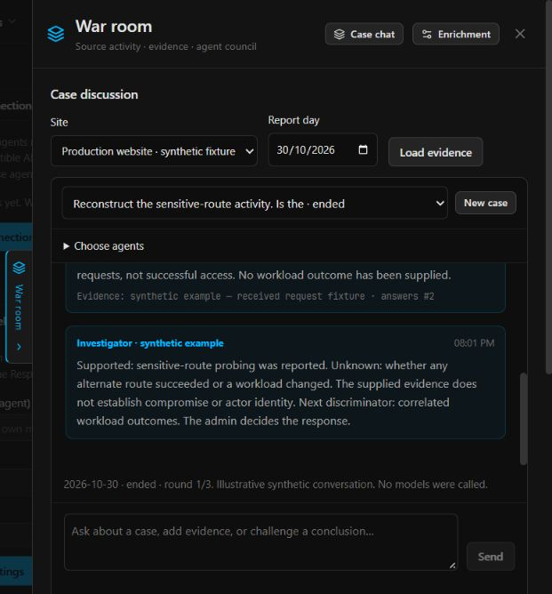

# War room case chat

War room uses one group chat in the existing drawer, with the hub's normal
neutral palette, typography, controls and blue accent. The activity map and
behavioral evidence remain available in expandable sections, without a new page
or window. Agent model and instruction settings remain in normal Settings.

## How a case works

1. Choose a site/date, the lead Investigator's worker, and up to four enrolled
   source agents. Participants and their order are fixed for that case.
2. The Investigator frames the case, separates leads from established facts and
   asks discriminating questions.
3. Each source specialist gets one turn, sequentially. It can add new cited
   evidence, answer a specific prior entry, correct a cited claim, or pass.
4. The Investigator closes with established, contradicted and unknown vectors,
   remaining evidence gaps and discriminators. It must not claim every possible
   attack vector has been discovered. The admin decides any response.
5. Follow-up questions can start another round with the same participants. There
   is no autonomous discussion after the conclusion.

These are read-only Investigator instances on the selected workers. Existing
responders, learners and reviewers keep their responsibilities and sessions.
Source specialists get only their own source's retained events and bounded synced
incident/finding summaries. The overview is site-wide context, as are the quoted
peer contributions intentionally shared with the selected participants. Browser
claims are excluded from source-specialist evidence reads. Lead turns retain the
site's explicit source grant. No shell, raw container inspection, secret reads or
response tools are granted. Missing live container data is an explicit limitation.
Research/model-generated cases are excluded from source-summary evidence so they
cannot serve as independent corroboration of themselves.

## Useful contributions and evidence

Source turns return a small JSON contribution: `kind` (`evidence`, `answer`,
`correction`, `pass`), `note`, `evidence` references and `addresses` chat-entry IDs.
Accepted facts need references actually returned by that job's broker, in the form
`event:<sequence>` or `record:<source>:<kind>:<id>`. The hub records at most 256
reference keys per grant, outside the analytics database. Chat entries are capped
at 2.4 KiB including JSON escaping; long model text is marked as an excerpt with
a link to the full native report. Oversized admin messages are rejected before
admission rather than silently shortened. A source contribution
has at most eight references, four addressed entries and 2,000 bytes of text.

The hub suppresses unread references, repeated text, repeated evidence-only
contributions and already-addressed evidence/question combinations. Answers and
corrections must name preceding entries. A pass or malformed contribution becomes
a small system status, not a fabricated agent answer. Details remain in the native
case. These checks establish citation provenance and bounded deduplication;
they do not prove a claim follows from its citations or detect every semantic
paraphrase. The role prompt requires relevance, alternatives and contradictions.
An administrator must still assess the reasoning. Peer assertions are untrusted
discussion, not an independent source of truth.

## Turn ownership, controls and limits

The hub dispatches one native job at a time per conversation, then waits for its
terminal reply before admitting the next turn. A durable version check reserves
the native message and conversation cursor in one transaction. Concurrent ticks
and hub restarts cannot admit the same turn twice. Jobs retain native semaphore,
model budget, replay protection, grant/query limits, Stop, transcript and billing.
The coordinator does not become a separate model process.

An admin message during a turn is stored for the next speaker. It does not steer
or interrupt the current native session. A message during a closing turn starts a
new round after that turn, subject to the three-round limit. Pause admits no new
turns; a dispatched turn can finish. End cancels a queued turn and prevents further
dispatch. For a dispatched/running session use the existing worker-case Stop
control. Pausing the final turn does not make its conclusion repeat on resume.
Unavailable workers/models or changed site scope pause the conversation visibly;
an expired native job requires reviewing live sessions and ending the old case.
Failed source turns remain explicit gaps. Models cannot nominate new participants,
call one another or authorize a response.

There is one active/paused case per site, at most 32 retained conversations across
the hub, at most 32 entries/96 KiB per conversation and a two-hour admission
lifetime. New input is refused near the entry limit to leave space for closing
turns. Each round has at most six model jobs (opening, four source turns, conclusion),
with at most three rounds. Ended turns and existing native cases remain subject
to their normal storage retention. Conversation metadata expires after 30 days
on new-case admission; explicit research-site deletion also clears its chats.
Normal server deletion does not erase unrelated analytics history.

The prompt references a broker snapshot of the most recent 12 discussion entries,
at most 700 UTF-8-safe bytes each, plus the latest admin question. Excerpts are
marked; this is a bounded context, not an unlimited transcript or a transactionally
consistent snapshot across both databases. The full stored chat stays visible to
the admin. Only a closing turn notifies through normal destinations/severity
filters; intermediate turns and passes do not flood notifications. Update workers
with this hub to apply the notification-presentation metadata.

Daily deterministic overviews and optional suspicious-traffic jobs keep their
separate opt-in settings. They do not automatically summon a group of agents.
Their individual reports remain expandable below the chat. No response voting,
automatic containment or autonomous participant discovery is implemented.

## UI example

This is a clearly labelled illustrative conversation in an isolated local fixture.
No live model, production telemetry or external enrichment was used.

